# DNS Server Step by Step

Author: Maximo (GitHub: maximo-sf)

## 1. Introduction

The DNS (Domain Name System) is a **hierarchical** naming system. The root (`.`)
delegates to top-level domains (`.es`, `.com`, `.test`...), which in turn delegate
to second-level domains and subdomains. A fully qualified domain name (FQDN) is
read from right to left, for example `debian.maximo.test.`

Concepts used in this project:

- **Zone**: the part of the namespace managed by a server. There is a **forward** zone (name → IP) and a **reverse** zone (IP → name).
- **Primary (master) server**: holds the original zone files.
- **Secondary (slave) server**: receives a copy of the zones through a zone transfer.
- **Records**: `SOA` (zone data), `NS` (name servers), `A` (name → IPv4), `CNAME` (alias), `TXT` (text) and `PTR` (IP → name).

## 2. Environment

| Item | Value |
|------|-------|
| Host | Windows |
| Virtualization | VirtualBox + Vagrant |
| Guest system | Debian 12 (`debian/bookworm64`) |
| Domain | `maximo.test` |
| Private network | `192.168.56.0/24` |
| Primary | `192.168.56.10` (`debian`) |
| Secondary | `192.168.56.11` (`debian2`) |

## 3. Creating the virtual machine

Command used:

```powershell
vagrant up primary
```

Vagrant downloads the Debian image, creates the VM with the private IP
`192.168.56.10`, runs `config/primary.sh` (installs and configures BIND) and, as
the last provisioner, runs `config/test.sh`, which launches the self-check
script. The output shows the three `OK` checks and the answers to the `dig` queries:

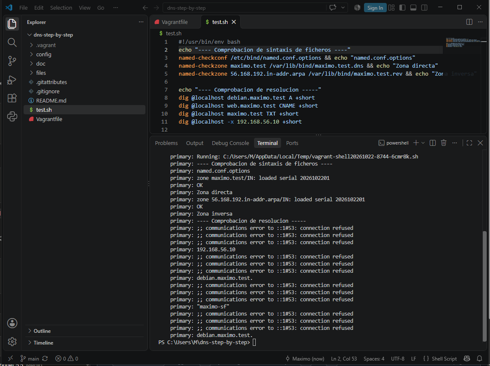

## 4. Installing BIND9

```bash
sudo apt update
sudo apt install -y bind9 bind9utils bind9-doc dnsutils
```

Installed version (`named` lives in `/usr/sbin`, so it is called with the full path):

```bash
/usr/sbin/named -v
```

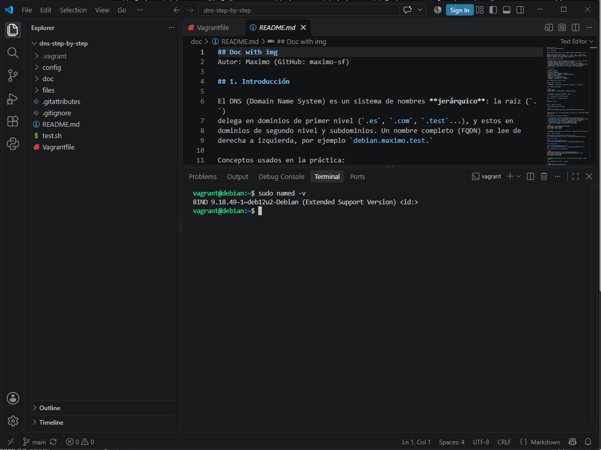

## 5. Configuring the primary server

### 5.1 IPv4 only (`/etc/default/named`)

```
OPTIONS="-u bind -4"
```

### 5.2 `named.conf.options`

Final content: see [`files/primary/named.conf.options`](../files/primary/named.conf.options).

Explanation of the main options:

- `acl confiables`: only these hosts can make recursive queries.
- `allow-transfer { none; }`: zone transfers are not allowed by default.
- `listen-on`: listens on port 53 on localhost and on the private IP.
- `recursion yes` + `allow-recursion`: recursion only for the ACL.
- `dnssec-validation auto`: DNSSEC validation enabled.
- `listen-on-v6` commented out: IPv6 queries are not answered.

```bash
named-checkconf /etc/bind/named.conf.options
echo "Resultado: $?"
sudo systemctl status named --no-pager
```

The syntax check returns `0` and the service is `active (running)`:

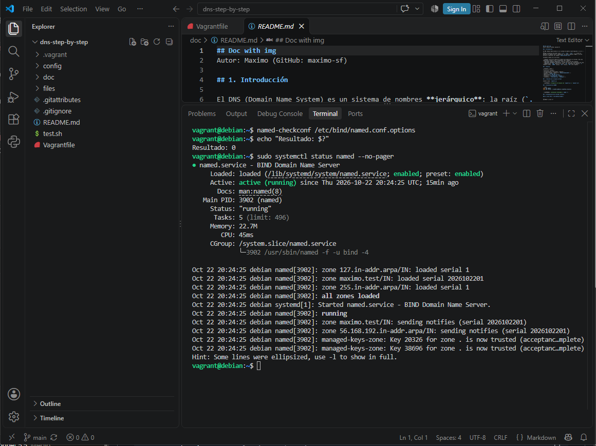

### 5.3 `named.conf.local`

Declaration of the forward and reverse zones as `master`.
See [`files/primary/named.conf.local`](../files/primary/named.conf.local).

### 5.4 Forward zone

File `/var/lib/bind/maximo.test.dns`.
See [`files/primary/maximo.test.dns`](../files/primary/maximo.test.dns).

### 5.5 Reverse zone

File `/var/lib/bind/maximo.test.rev`.
See [`files/primary/maximo.test.rev`](../files/primary/maximo.test.rev).

### 5.6 Checking the zones

```bash
named-checkzone maximo.test /var/lib/bind/maximo.test.dns
named-checkzone 56.168.192.in-addr.arpa /var/lib/bind/maximo.test.rev
sudo journalctl -u named --no-pager | grep "loaded serial"
```

Both zones return `OK` and the log shows them loaded:

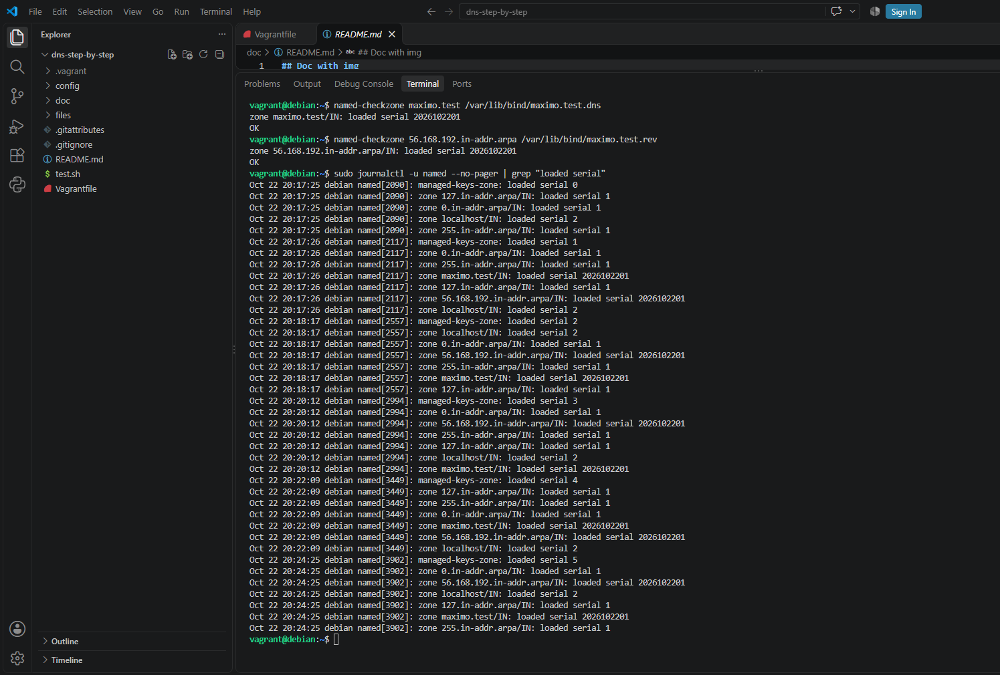

## 6. Verification with `dig` and `nslookup`

```bash
dig @192.168.56.10 debian.maximo.test
nslookup debian.maximo.test 192.168.56.10
```

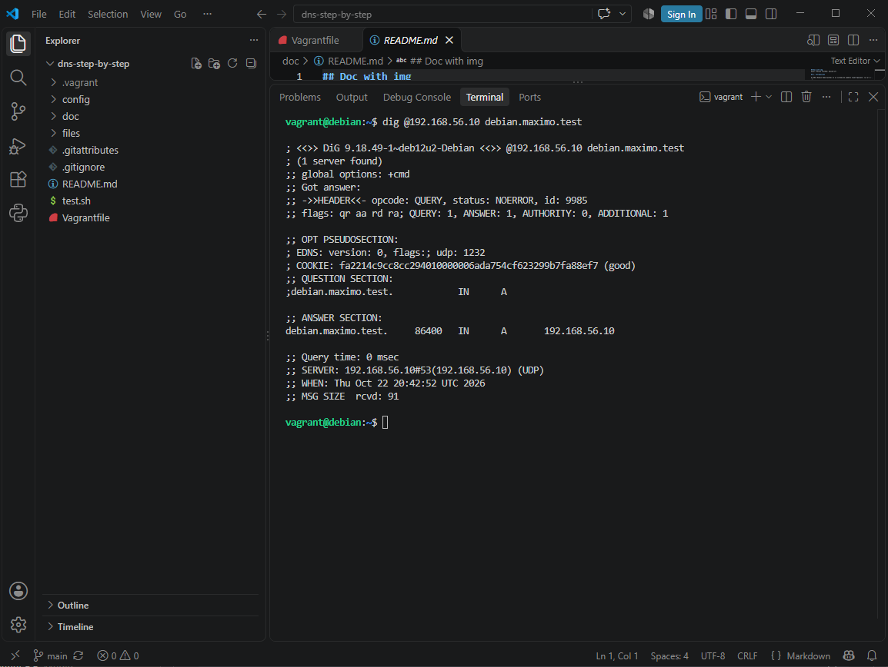

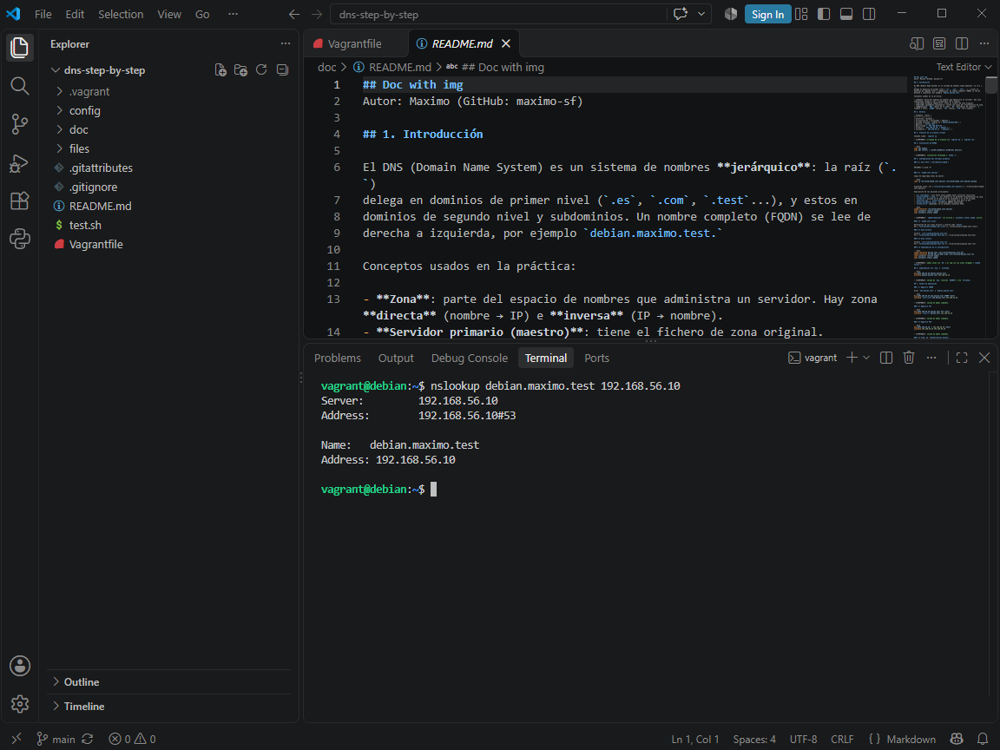

## 7. Extension tasks

### 7.1 CNAME record

Alias `web.maximo.test` → `debian.maximo.test`.

```bash
dig @192.168.56.10 web.maximo.test CNAME +short
nslookup -type=cname web.maximo.test 192.168.56.10
```

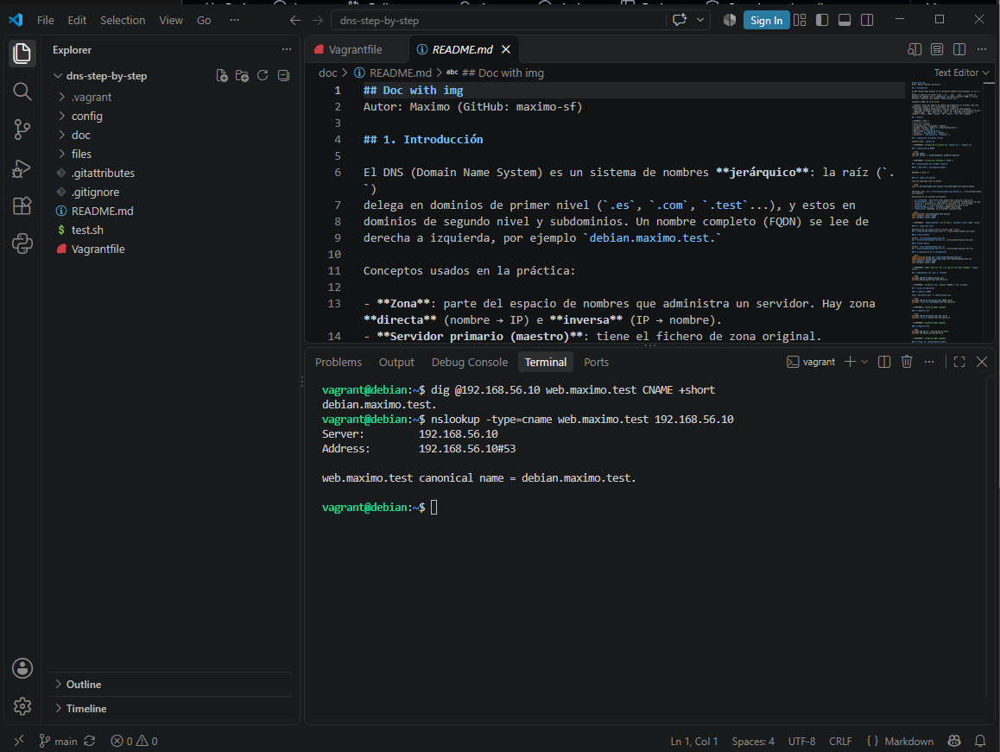

### 7.2 TXT record

A `TXT` record in the zone root contains the GitHub username.

```bash
dig @192.168.56.10 maximo.test TXT +short
nslookup -type=txt maximo.test 192.168.56.10
```

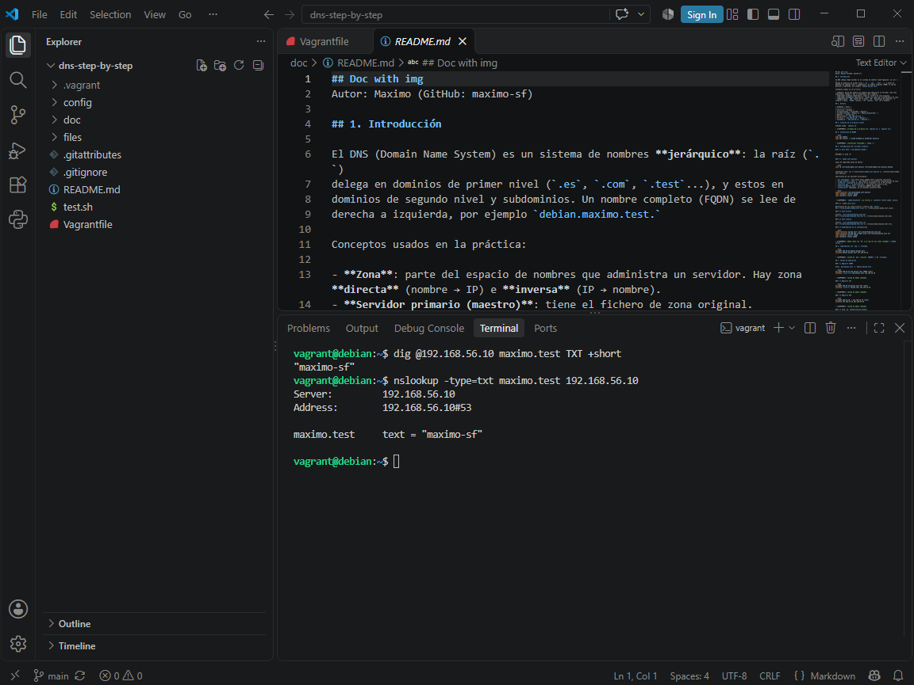

### 7.3 PTR record

The IP of the server resolves to its FQDN.

```bash
dig @192.168.56.10 -x 192.168.56.10 +short
nslookup 192.168.56.10 192.168.56.10
```

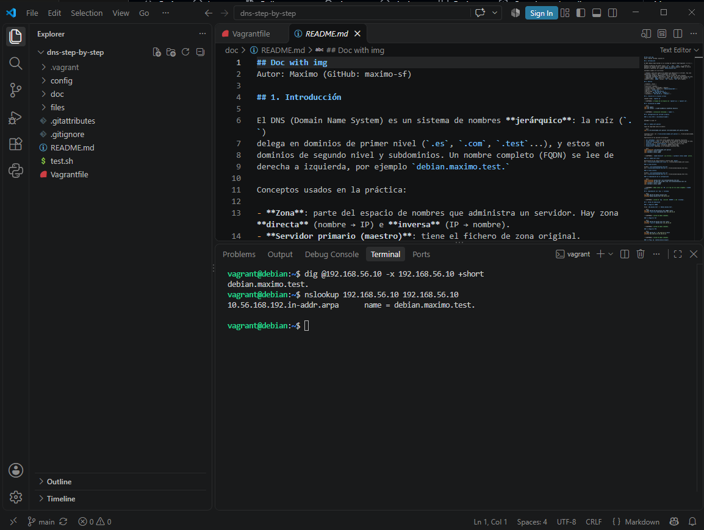

### 7.4 `aa` flag (Authoritative Answer)

```bash
dig @192.168.56.10 debian.maximo.test | grep -E "HEADER|flags"
dig @192.168.56.10 www.google.es | grep -E "HEADER|flags"
```

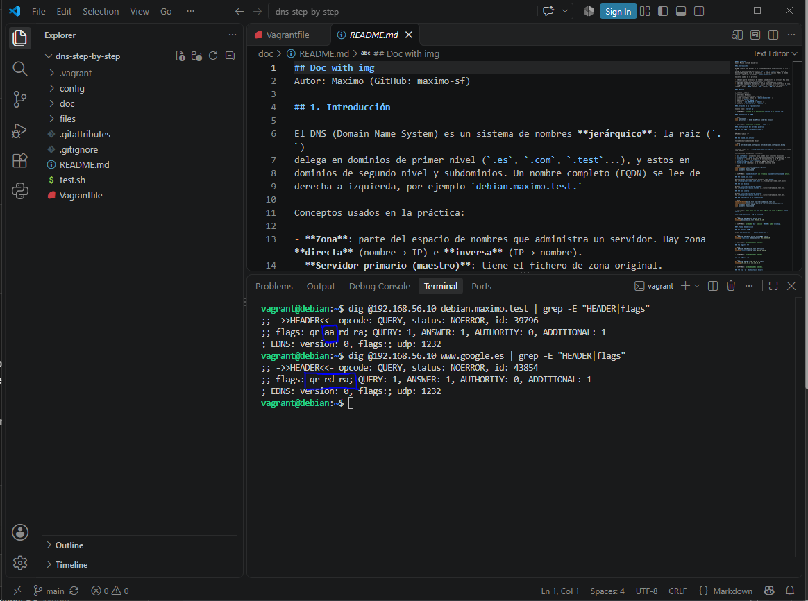

The `aa` flag appears for our domain because the server is authoritative for
that zone, and it does not appear for `www.google.es` because the answer is
obtained recursively, without the server being authoritative for that domain.

### 7.5 Self-check script

The [`test.sh`](../test.sh) file validates the syntax of the files and the name
resolution against `127.0.0.1`. It runs automatically as the last Vagrant
provisioner (`config/test.sh`).

```bash
bash /vagrant/test.sh
```

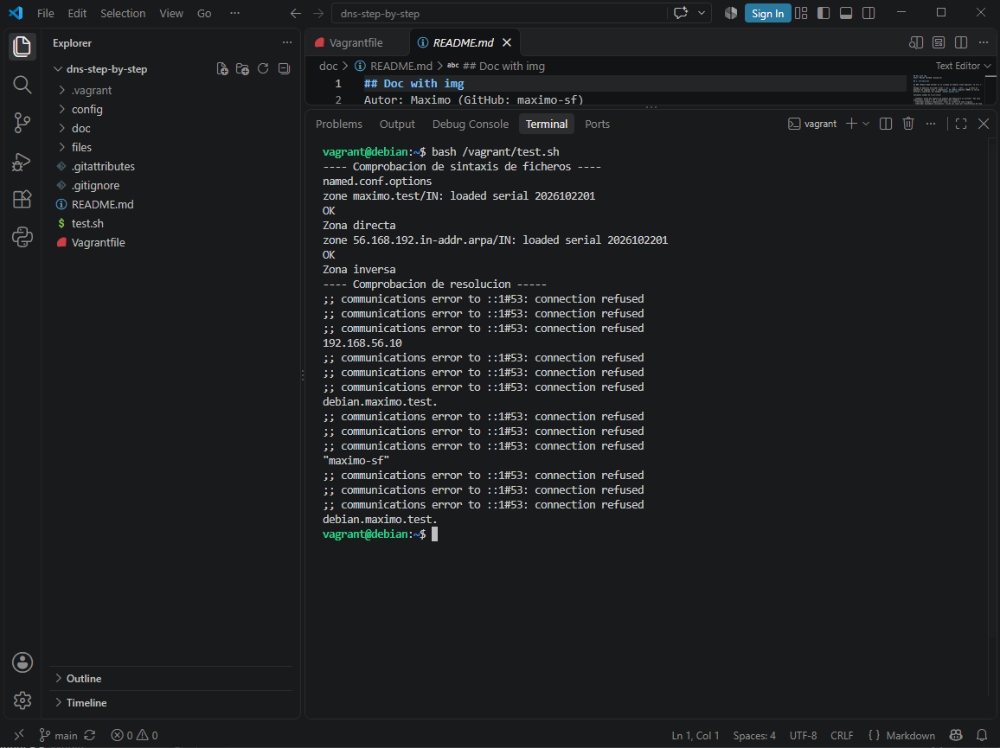

## 8. Secondary server

### 8.1 Second virtual machine

Defined in the `Vagrantfile` with the IP `192.168.56.11` and started with:

```powershell
vagrant up secundary
```

### 8.2 Zone transfers on the primary

In `named.conf.local` of the primary, `allow-transfer { 192.168.56.11; };` is added to each zone.

### 8.3 Configuring the secondary

- `named.conf.options`: [`files/secundary/named.conf.options`](../files/secundary/named.conf.options)
- `named.conf.local` (`slave` zones): [`files/secundary/named.conf.local`](../files/secundary/named.conf.local)

The zone files are not created on the secondary: the primary transfers them.

### 8.4 Checking the transfer

```bash
sudo journalctl -u named --since "10 minutes ago"
```

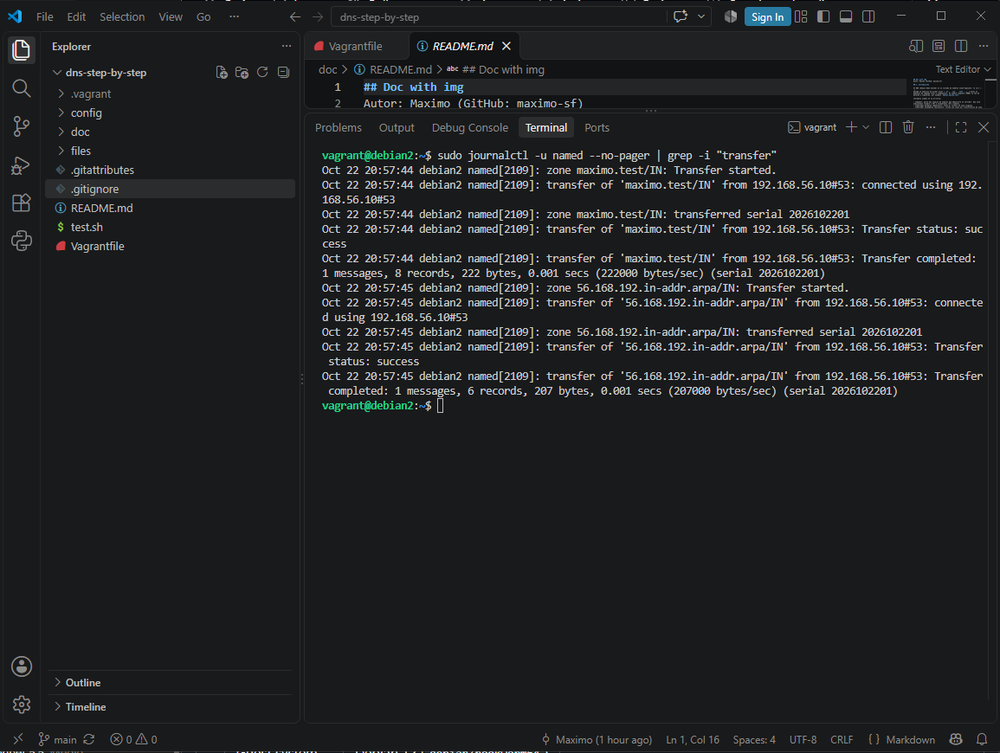

```bash
dig @192.168.56.11 maximo.test SOA +norecurse
dig @192.168.56.11 debian.maximo.test A +short
dig @192.168.56.11 -x 192.168.56.10 +short
dig @192.168.56.10 maximo.test SOA +short
dig @192.168.56.11 maximo.test SOA +short
```

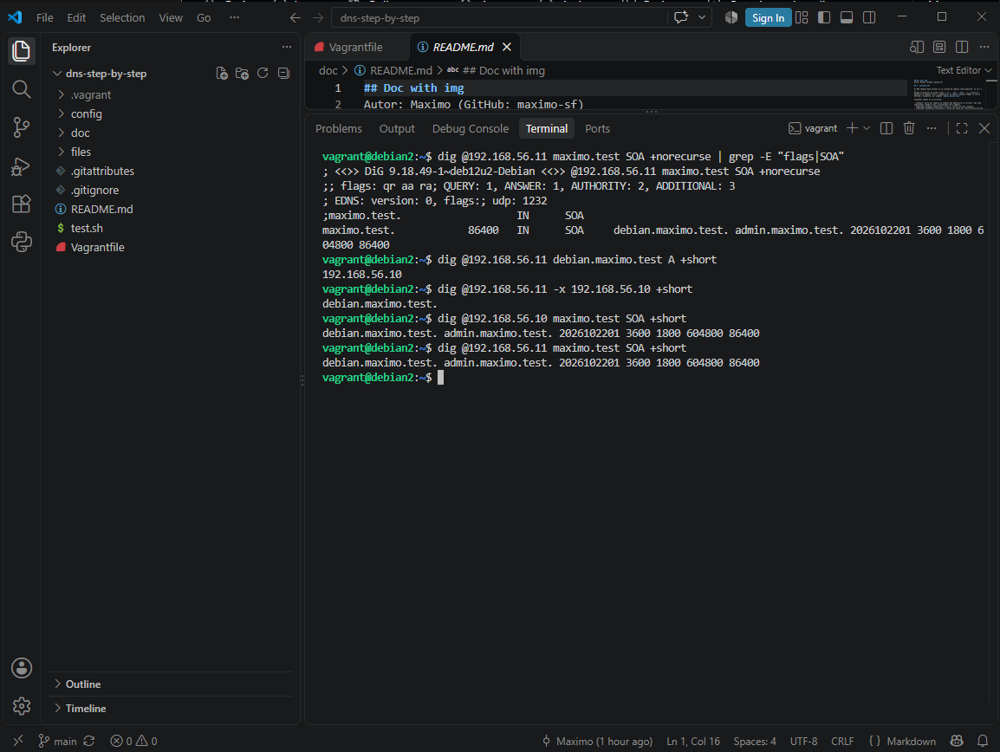

## 9. Automated deployment with Vagrant

The whole deployment is done with `vagrant up`:

| Script | Function |
|--------|----------|
| `config/primary.sh` | Installs BIND, copies the configuration and zone files, restarts the service |
| `config/secundary.sh` | Installs BIND and configures the slave zones |
| `config/test.sh` | Runs `/vagrant/test.sh` |


## 10. Problems found

| Problem | Cause | Solution |
|---------|-------|----------|
| `path for shell provisioner does not exist` | The script names did not match the paths written in the `Vagrantfile` | Made the paths in the `Vagrantfile` and the scripts match the real file names |
| `bash: /vagrant/test.sh: No such file or directory` | The file was named `test-sh` instead of `test.sh` | Renamed it with `git mv test-sh test.sh` |
| `dig: Invalid option: +short` | `test.sh` had Windows line endings (CRLF), so Linux saw an invisible `\r` after each option | Converted the scripts to LF and added `*.sh text eol=lf` to `.gitattributes` |
| `communications error to ::1#53: connection refused` | `dig @localhost` tries IPv6 first and BIND only listens on IPv4 | Used `@127.0.0.1` in `test.sh` |
| `named: command not found` | `named` is in `/usr/sbin`, which is not in the PATH of a normal user | Ran it with the full path `/usr/sbin/named -v` |
| `GH007: Your push would publish a private email address` | The commit used my real email while GitHub email privacy was enabled | Configured the GitHub `noreply` email in Git and recreated the commit |
| `Can't push refs to remote. Try running "Pull" first` | The remote had commits that were not in the local repository | Synchronized with `git pull` before pushing |
